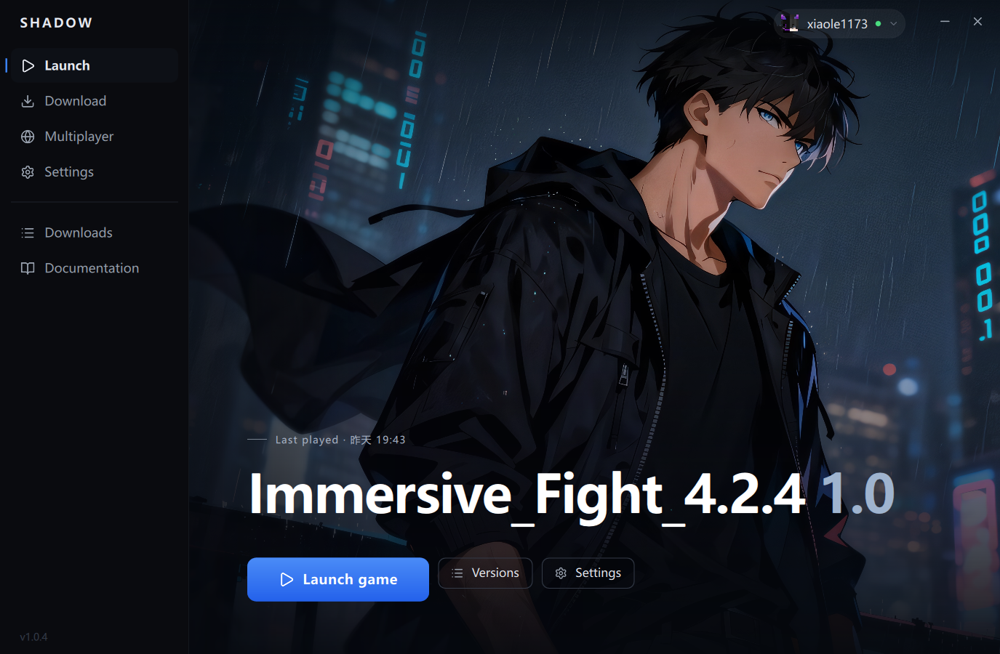

# Shadow Launcher v2

一款开源、免费的 Minecraft 启动器。第二代 —— 后端沿用，界面全部重写。



## 为什么有 v2

一代启动器的 C++ 后端经过多轮迭代，历史包袱越来越重：界面的问题已经不再是「调一调颜色和间距」能解决的层次，任何一处视觉改动都要先在旧结构里绕一圈，代价高到不划算。

所以 v2 的选择是：**后端沿用，界面重来**。UI 全部用 QML 重写，从设计令牌（颜色、间距、圆角、动效时长）开始重新定义，而不是在旧界面上贴补丁。

顺带修掉了 v1 沉积下来的一批问题，下载链路是重灾区 —— 多源并发、分片与运行中换源、断点续传、SHA1 校验都被重新实现过；启动、版本隔离、整合包导入也做了针对性优化。

一代仓库：[xiaole1173/shadow-launcher](https://github.com/xiaole1173/shadow-launcher)

## 特性

- **下载引擎**：多源镜像并发、大文件分片下载与运行中换源、断点续传、SHA1 校验、限速、失败自动重试
- **版本管理**：版本隔离（每个版本独立的 mods / 配置 / 存档目录）、版本快速复制
- **整合包**：导入与导出，兼容常见整合包清单格式
- **资源管理**：模组、光影、资源包、存档的分类查看与安装
- **Java**：自动扫描本机 Java，也支持在线下载安装对应版本
- **账号**：微软正版登录、外置登录（Yggdrasil）
- **多人游戏**：服务器列表与快速进服
- **多语言**：简体中文、香港繁体、台湾繁体、English
- **崩溃诊断**：崩溃检测、日志归档与分析产物

## 技术栈

| 项 | 版本 / 说明 |
|---|---|
| 语言 | C++（后端）+ QML（界面） |
| 框架 | Qt 6.8（Core / Gui / Quick / Network / Widgets） |
| 编译器 | MSVC 2022（x64） |
| 构建 | CMake 3.21+ |
| 当前版本号 | 见 [`src/version.h`](src/version.h) 的 `SHADOW_DISPLAY_VERSION`（唯一来源） |

## 目录结构

```
src/            C++ 后端（core 引擎、backend 桥接层、session 运行时）
ui/             新一代 QML 界面（当前唯一在开发的界面）
  Main.qml      入口窗口（无边框 / 透明 / 最小 800x550）
  Theme.qml     设计令牌单例（颜色、间距、圆角、动效）
  StageShell.qml  侧栏 + 内容区骨架
  SideBar.qml   左侧导航
  pages/        各功能页
  controls/     基础控件（按钮、图标、分段控件、Toast 等）
  assets/       内置背景图
i18n/           四套译文（zh_CN / zh_HK / zh_TW / en）
icons/          图标资源（lucide SVG 为主）
thirdparty/     WebView2 登录 SDK、miniz、libwebp
resources/      内嵌资源与 qrc
cmake/ tools/   构建脚本与开发工具
tests/ docs/    测试与文档
```

## 构建

前置：Qt 6.8（`msvc2022_64`）、Visual Studio 2022（含 C++ 工作负载）、CMake 3.21+。

```powershell
cmake -S . -B build -G "Visual Studio 17 2022" -A x64 \
      -DCMAKE_PREFIX_PATH="C:/Qt/6.8.3/msvc2022_64"
cmake --build build --config Release --parallel
```

产物：`build\Release\ShadowLauncher.exe`。直接双击即进入新界面 —— 旧 UI 已于 2026-11-10 整体移除，不存在第二套入口。

清理构建产物请只删已知文件，**不要** `Remove-Item build -Recurse -Force`：

```powershell
cmake --build build --target clean
```

## 开发辅助参数

启动器带一组仅开发时使用的命令行开关：

| 参数 | 用途 |
|---|---|
| `--log-selftest` | 日志系统自检（折叠、文件头、告警摘要、保留份数），跑完即退出 |
| `--screenshot <path>` | 启动后截图保存，用于界面回归 |
| `--navigate <page>` | 直接跳转到指定页面 |
| `--ui-selftest-settings` | 设置页逐一巡视，检查每个 pane 能否正常渲染 |
| `--ui-next-mode / --ui-next-density / --ui-next-size` | 覆盖外观模式、密度、窗口尺寸 |

日志按「每一次运行一个文件」写入 `<exe目录>/logs/shadow_launcher_<时间戳>.log`，只保留最近 10 份；告警与错误另存 `logs/errors.log`，跨会话保留。上次运行若是被强杀或崩溃，下次启动会在日志首行报出来。

## UI 硬规则

这些是踩过的坑，改界面前先读：

1. **图标一律 SVG**（`icons/lucide/*.svg`），禁止 emoji 或 Unicode 符号当图标。
2. **禁止 `SpringAnimation`**：实测数值会发散到 `-Infinity`，控件直接消失。
3. **禁止整窗 `layer.enabled` + `MultiEffect`**：会触发纹理重分配，表现为文字瞬间放大、控件消失。小图标上色用 `MultiEffect` 可以。
4. **首屏是「一个决定 + 一个按钮」**，不要摊成等权卡片网格。
5. **首屏信息准入判据**：一个元素能留下，唯一理由是它能改变用户下一步的动作；说不出改变哪个决定就删掉。
6. **常态不说话**：不显示「就绪 / 准备就绪」，只有异常才提示。
7. 颜色、间距、动效一律取自 `Theme`，不在页面里写死数值。

## 文档

- [CODE_INDEX.md](CODE_INDEX.md) —— 全量代码索引（模块职责、关键函数、改动的来龙去脉）
- [design/DESIGN_SPEC.md](design/DESIGN_SPEC.md) —— 界面设计规范；历次验收记录在 `design/` 下
- [DOWNLOAD_CONTRACT.md](DOWNLOAD_CONTRACT.md) —— 下载引擎的接口契约与状态机
- [PROJECT_STATUS.md](PROJECT_STATUS.md) —— 当前阶段与已知问题

## 许可

本项目以 **GNU Affero General Public License v3.0 or later（AGPL-3.0-or-later）** 发布，与一代 Shadow Launcher 保持一致 —— 许可信息沿用自 [xiaole1173/shadow-launcher](https://github.com/xiaole1173/shadow-launcher)，全文见根目录 [LICENSE](LICENSE)。

这意味着：

- 你可以自由使用、修改、分发本项目；
- 分发修改版时，必须同样以 AGPL-3.0 开源，并提供完整源码；
- **即使只在网络上提供服务**（例如把本启动器做成在线服务），也构成分发，必须向使用者提供源码。

源码文件头的 `SPDX-License-Identifier: AGPL-3.0-or-later` 即为逐文件的许可声明。

## 致谢

- [Qt](https://www.qt.io/) —— 界面与网络框架
- [Lucide](https://lucide.dev/) —— 图标集
- [miniz](https://github.com/richgel999/miniz)、[libwebp](https://chromium.googlesource.com/webm/libwebp) —— 第三方库
- 以及一代 Shadow Launcher 的所有使用者与反馈者
